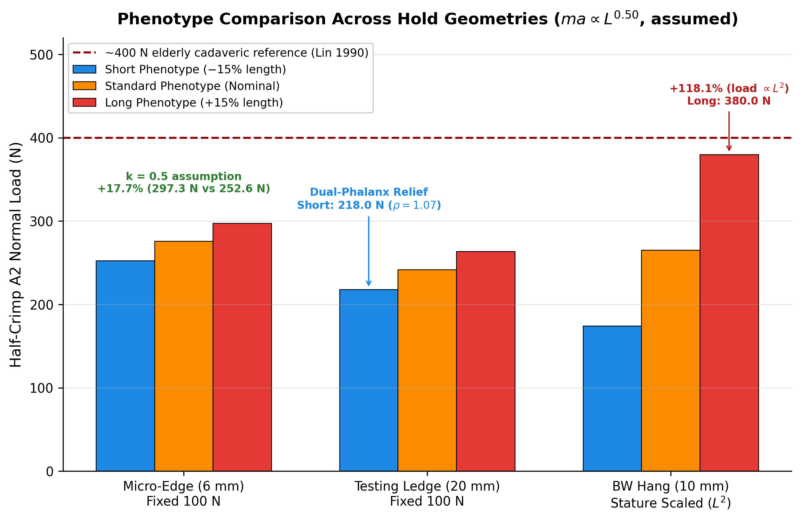

# A Three-Dimensional Musculoskeletal Model of the Human Finger in Rock Climbing: Contact Mechanics, Pulley Shearing, and Phenotypic Scaling

**Author:** Igor Cerovsky  
*Independent Climbing Physics Researcher*  
**Date:** October 14, 2026  
*Correspondence:* [igor.cerovsky@gmail.com](mailto:igor.cerovsky@gmail.com)  
*Open Source Repository:* [https://github.com/igorcerovsky/finger](https://github.com/igorcerovsky/finger)  

---

## Abstract

High-intensity sport climbing imposes extreme mechanical loads on the digital flexor apparatus, frequently causing annular pulley ruptures and capsuloligamentous sprains. Classical planar models treat the digit as a two-dimensional linkage subjected to a point load at the anatomical fingertip, neglecting hold depth interactions ($2\text{--}45\text{ mm}$) and out-of-plane joint loading during side-pulls and gastons. We developed a three-dimensional, four-degree-of-freedom (4-DOF) musculoskeletal model of the middle finger (metacarpophalangeal [MCP] flexion and radial abduction, proximal interphalangeal [PIP] flexion, and distal interphalangeal [DIP] flexion). The framework integrates: (1) dual-phalanx distributed contact mechanics across the distal (DP) and middle (MP) phalanges with Hertzian micro-edge corner stress concentration; (2) non-linear fingertip pulp compliance and load-dependent skin tribology; (3) flexion-dependent instantaneous centers of rotation (ICR); (4) Capstan sheath friction across the A1, A2, and A4 pulleys; and (5) micro-CT-calibrated moment arms for six muscle-tendon units (FDP, FDS, LU, EDC, RI, UI) solved via electromyography (EMG)-constrained bounded least-squares and 3-DOF kinematic chain posture optimization. Across deep holds ($d_{hold} > L_{DP} \approx 22\text{ mm}$), contact bridges the DIP joint onto the MP, shifting prime-mover recruitment from the flexor digitorum profundus (FDP) to the flexor digitorum superficialis (FDS) at a scale-invariant dimensionless hold depth $\tilde{d} = d_{hold}/L_{DP} \approx 1.52$ in the half-crimp posture. In local anatomical coordinate frames, mid-shaft A2 bowstringing remains in-plane during flexion, whereas $15^\circ$ of MCP radial abduction concentrates severe transverse redirection shear at the A1 pulley entrance ($137.3\text{ N}$ under a $171.7\text{ N}$ load) alongside PIP mediolateral collateral ligament shear ($44.4\text{ N}$). Evaluating phenotypic digit scaling ($\pm 15\%$ length) under realistic sub-linear condyle allometry ($ma \propto L^{0.50}$) and micro-edge cantilever mechanics reveals that longer digits incur an intrinsic $+17.7\%$ A2 pulley force disadvantage on $6\text{ mm}$ edges at equal tip loads ($297.3\text{ N}$ vs. $252.6\text{ N}$), fail to achieve dual-phalanx unloading on standard $20\text{ mm}$ testing edges ($\rho = d/L_{DP} = 0.79$ vs. $1.07$), and experience a $+118.1\%$ A2 pulley load surge during stature-scaled bodyweight hangs ($380.0\text{ N}$ vs. $174.2\text{ N}$). These findings establish the mechanical basis for individualized edge normalization ($d_{test} = 0.80 L_{DP}$) and phenotype-specific injury prevention.

**Keywords:** Finger biomechanics; Rock climbing; Annular pulley; A1 pulley shear; Crimp grip; Contact mechanics; Allometric scaling.

---

## 1. Introduction

The evolution of competitive and recreational rock climbing has pushed athletes to grasp microscopic edges ($<10\text{ mm}$) and execute dynamic lateral movements that generate extreme internal tendon tensions (Schweizer, 2001; Schöffl et al., 2003). Consequently, pathologies of the digital flexor pulley system—predominantly the A2 and A4 annular pulleys—and collateral ligament sprains account for over 40% of all climbing injuries (King and Lien, 2017; Lutter et al., 2020).

Foundational two-dimensional (2D) planar models (An et al., 1983; Schweizer, 2001; Vigouroux et al., 2006) demonstrated that the full crimp grip—defined by acute PIP flexion ($90^\circ\text{--}105^\circ$) and DIP hyperextension ($-15^\circ\text{ to }-25^\circ$)—imposes disproportionate tension on the flexor digitorum profundus (FDP) and subjects the A2 pulley to normal bowstringing loads approaching three times the applied fingertip force. However, existing biomechanical models exhibit three critical limitations:

1. **The Point-Load Approximation:** Standard models apply external reaction forces exclusively as a point load at the distal tip ($d_{hold} = 0$). In practice, climbing holds span from micro-edges ($2\text{--}8\text{ mm}$) to deep ledges ($>22\text{ mm}$). When hold depth exceeds the distal phalanx length ($L_{DP}$), palmar skin contact bridges the DIP crease onto the middle phalanx (MP), altering external joint moments across the DIP and PIP joints (Bourne et al., 2011; Amca et al., 2012).
2. **Neglect of Out-of-Plane Shearing:** Side-pulls, gastons, and compression moves force the metacarpophalangeal (MCP) joint into radial abduction or adduction. Planar models cannot resolve mediolateral (ML) joint shear or differentiate mid-shaft pulley hoop stress from transverse entrance redirection shear.
3. **The Anthropometric Phenotype Gap:** Training interventions and strength assessments universally evaluate climbers on fixed-depth rungs (typically $20\text{ mm}$) while treating the human digit as an anthropometrically invariant lever (López-Rivera and González-Badillo, 2019; Stien et al., 2023). While athletes and clinicians consistently observe that long-fingered climbers find small crimps disproportionately difficult, theoretical analyses have lacked a unified model incorporating realistic condyle allometry, micro-edge cantilever mechanics, and bodyweight scaling.

The objectives of this study are to formulate and validate a 3D musculoskeletal model of the climbing finger that: (1) resolves continuous dual-phalanx (DP and MP) contact mechanics with pulp compliance and micro-edge stress concentration; (2) quantifies 3D pulley and joint shear forces in local anatomical versus global frames; (3) benchmarks CT-calibrated pulley-constrained moment arms against general-purpose musculoskeletal simulators (MyoSuite/MyoHand); and (4) quantifies the biomechanical mechanisms governing the long-finger disadvantage on small holds.

---

## 2. Methods

### 2.1 3D Kinematics and Instantaneous Centers of Rotation

The middle finger (Digit III) is modeled as an open kinematic chain of three segments—proximal phalanx (PP, $L_1 = 45.0\text{ mm}$), middle phalanx (MP, $L_2 = 28.0\text{ mm}$), and distal phalanx (DP, $L_3 = 22.0\text{ mm}$)—articulated at the MCP (spatial origin $\vec{p}_{MCP} = \vec{0}$), PIP, and DIP joints. In the global Cartesian frame, $\hat{e}_x$ points perpendicularly into the wall, $\hat{e}_y$ points dorsally (upward), and $\hat{e}_z$ points radially (toward the thumb).

Flexion angles ($\theta_{MCP}, \theta_{PIP}, \theta_{DIP}$) rotate about the local transverse $z$-axis toward the palm ($-\hat{e}_y$), while MCP radial abduction ($\phi_{MCP}$) rotates about the local $y$-axis toward $+\hat{e}_z$:

$$R_{flex}(\theta) = \begin{pmatrix} \cos\theta & \sin\theta & 0 \\ -\sin\theta & \cos\theta & 0 \\ 0 & 0 & 1 \end{pmatrix}, \quad R_{abd}(\phi) = \begin{pmatrix} \cos\phi & 0 & -\sin\phi \\ 0 & 1 & 0 \\ \sin\phi & 0 & \cos\phi \end{pmatrix}$$

Global segment orientations are obtained by sequential composition: $R_{MCP} = R_{flex}(\theta_{MCP}) R_{abd}(\phi_{MCP})$, $R_{PIP} = R_{MCP} R_{flex}(\theta_{PIP})$, and $R_{DIP} = R_{PIP} R_{flex}(\theta_{DIP})$. To capture articular condyle translation during flexion, an affine palmar Instantaneous Center of Rotation (ICR) offset $\vec{\delta}_J(\theta_J) = [0, -c_{max,J}(\theta_J / 90^\circ), 0]^T$ ($c_{max,PIP} = 2.0\text{ mm}$, $c_{max,DIP} = 1.5\text{ mm}$) is included in the forward kinematics:

$$\vec{p}_{PIP} = \vec{p}_{MCP} + R_{MCP}(L_1 \hat{e}_x + \vec{\delta}_{PIP}), \quad \vec{p}_{DIP} = \vec{p}_{PIP} + R_{PIP}(L_2 \hat{e}_x + \vec{\delta}_{DIP}), \quad \vec{p}_{TIP} = \vec{p}_{DIP} + R_{DIP}(L_3 \hat{e}_x)$$

### 2.2 Dual-Phalanx Contact Mechanics, Pulp Compliance, and Tribology

For a hold of depth $d_{hold}$, edge radius $r_{edge} = 2.0\text{ mm}$, and surface normal $\hat{n}_{hold} = [\cos\beta_{wall}, -\sin\beta_{wall}, 0]^T$, the projected hold depth is $d_{proj} = d_{hold} + r_{edge}|\hat{e}_{DP} \cdot \hat{n}_{hold}|$, with segment angular projection $\cos\alpha_k = \max(\|\hat{e}_k \times \hat{n}_{hold}\|, 0.05)$.

Under compressive load $F_{mag}$, hyperelastic fingertip pulp deformation follows Serina et al. (1997): $\delta(F_{mag}) = \min(k_p \ln(1 + F_{mag}/F_0), \delta_{max})$ ($k_p = 1.15\text{ mm}$, $F_0 = 10.0\text{ N}$, $\delta_{max} = 2.5\text{ mm}$). Palmar pad thickness scales with skeletal caliber ($t_{DP} = t_{DP,0} f^{0.50}$, $t_{DP,0} = 9.0\text{ mm}$), yielding an effective palmar contact offset $r_{palmar} = \max(t_{DP}/2 - \delta(F_{mag}), 1.0\text{ mm})$.

1. **Shallow Holds ($d_{proj} \le L_3 \cos\alpha_3$):** Contact is confined to the DP ($d_{eff} = d_{proj}/\cos\alpha_3$). On wide ledges, pressure follows a linear triangular distribution peaking at the distal tip ($s_C = d_{eff}/3$). On micro-edges ($d_{eff} \le d_{trans} = 4.0\text{ mm}$), Hertzian corner stress concentration shifts the center of pressure toward the hold lip (Johnson, 1985):
   $$s_C = \frac{d_{eff}}{3} \tanh\left(\frac{d_{eff}}{d_{trans}}\right)$$
   leaving an unsupported distal phalanx bone cantilever of length $L_{cantilever} = L_3 - s_C$.
2. **Deep Holds ($d_{proj} > L_3 \cos\alpha_3$):** Contact bridges the DIP crease onto the MP over length $x_{MP} = \min((d_{proj} - L_3 \cos\alpha_3)/\cos\alpha_2, L_2 - 0.5\text{ mm})$. Integrating the triangular DP profile ($\text{Area}_{DP} = L_3/2$) and ramp MP profile ($\text{Area}_{MP} = x_{MP}^2 / [2(L_3 + x_{MP})]$) yields the normal force fractions $f_{DP} = \text{Area}_{DP} / (\text{Area}_{DP} + \text{Area}_{MP})$ and $f_{MP} = 1 - f_{DP}$. The MP contact centroid combines the geometric pressure centroid ($40\%$) with the A3 pulley skeletal anchor ($60\%$, at $0.15 L_2$ from PIP; Moutet, 2003).

Non-linear skin friction on rock/resin accounts for epidermal asperity saturation under normal load $F_N$ (Fuss and Niegl, 2008; Derler and Gerhardt, 2012):
$$\mu_{eff}(F_N) = \text{clip}\left(\mu_0 \left(\frac{F_{ref}}{\max(F_N, 1.0)}\right)^{1-n}, 0.25, 0.85\right)$$
with $\mu_0 = 0.50$, $F_{ref} = 20.0\text{ N}$, and $n = 0.85$.

### 2.3 Musculoskeletal Architecture, Allometric Scaling, and Indeterminacy Solver

Equilibrium across the 4 DOFs (DIP, PIP, MCP flexion, and MCP abduction) is governed by six muscles: Flexor Digitorum Profundus (FDP), Flexor Digitorum Superficialis (FDS, where $ma_{FDS,DIP} = 0$), Lumbrical (LU), Extensor Digitorum Communis (EDC), and Radial/Ulnar Interossei (RI, UI). Angle-dependent moment arms were calibrated via linear regression ($R^2 \ge 0.99$) to micro-CT tendon path coordinates from Synek et al. (2019; *PeerJ 7470*), retaining the An et al. (1983) DIP flexor baseline to prevent unmodeled distal capsule artifacts:

$$\begin{aligned}
ma_{FDP,DIP} &= \max(6.00 + 0.045\,\theta_{DIP},\ 2.0)\text{ mm}, \quad &ma_{FDP,PIP} &= \max(8.24 + 0.050\,\theta_{PIP},\ 4.0)\text{ mm} \\
ma_{FDP,MCP} &= \max(9.89 + 0.087\,\theta_{MCP},\ 6.0) + \Delta ma_{w}, \quad &ma_{FDS,PIP} &= \max(4.44 + 0.050\,\theta_{PIP},\ 3.0)\text{ mm} \\
ma_{FDS,MCP} &= \max(10.13 + 0.108\,\theta_{MCP},\ 5.0) + \Delta ma_{w}
\end{aligned}$$

where $\Delta ma_w = k_{wrist} \theta_{wrist}$ ($k_{wrist} = 0.04\text{ mm/deg}$, $\theta_{wrist} = 25^\circ$, $\Delta ma_w = 1.0\text{ mm}$) represents a phenomenological approximation of wrist extension tenodesis (Lutter et al., 2021). Extensor hood transmission fractions follow Synek et al. (2019) for LU ($0.621$ radial band, $0.379$ central slip) and RI/UI ($0.232$ terminal tendon, $0.612$ central slip).

#### Sub-Linear Condyle Allometry
In human skeletal allometry, phalangeal elongation is primarily longitudinal along the diaphysis, whereas joint condyle radii and tendon moment arms scale sub-linearly with transverse bone caliber (Schmidt and Krause, 2011; Synek et al., 2019):
$$ma(f) = ma_{std} \cdot f^k, \quad k = 0.50$$
where $f = L / L_{std} \in \{0.85, 1.00, 1.15\}$ defines the Short, Standard, and Long phenotypes. (Strict linear isometry, $k = 1.0$, is evaluated only as a theoretical null baseline).

#### Capstan Friction and EMG-Constrained Solver
During isometric holding at the threshold of forced extension (eccentric limit), tendon-sheath friction ($\mu_t = 0.08$; Schweizer, 2003; Moor et al., 2009) amplifies distal tendon tension according to the Euler-Eytelwein capstan equation: $C_{A2} = e^{\mu_t \theta_{A2}}$ and $C_{A4} = e^{\mu_t \theta_{A4}}$. Passive volar-plate resistance absorbs $25\%$ of external extension moments when $\theta_{DIP} < 0^\circ$ or $\theta_{MCP} < 0^\circ$ (Vigouroux et al., 2006), while DIP hyperextension triggers an exponential passive/active extensor stiffness floor $F_{EDC,min} = 1.5 e^{|\theta_{DIP}|/25^\circ}\text{ N}$ ($\approx 3.7\text{ N}$ at $\theta_{DIP} = -22.6^\circ$).

To resolve muscle redundancy physiologically, FDP and FDS are coupled via an EMG co-contraction ratio $F_{FDP} = r_{emg}(f_{DP}) F_{FDS}$:
$$r_{emg}(f_{DP}) = r_{base}(0.20 + 0.80 f_{DP})$$
where $r_{base}$ matches in vivo shallow-edge EMG ratios (Vigouroux et al., 2006): $1.75$ (Full Crimp), $1.20$ (Half-Crimp), and $0.88$ (Open Hand). The $4 \times 5$ system for $[F_{FDS}, F_{LU}, F_{EDC}, F_{RI}, F_{UI}]^T$ is solved via Tikhonov-regularized ($\lambda = 10^{-4}$) bounded least-squares (`scipy.optimize.lsq_linear`), departing from unconstrained quadratic stress optimization (Crowninshield and Brand, 1981) to enforce physiological cross-sectional area capacity bounds ($F_i \le \text{PCSA}_i \cdot \sigma_{max}$, $\sigma_{max} = 35\text{ N/cm}^2$; $\text{PCSA}_{LU} = 0.4$, $\text{PCSA}_{EDC} = 2.0$, $\text{PCSA}_{RI} = 2.8$, $\text{PCSA}_{UI} = 2.2\text{ cm}^2$; Lieber and Fridén, 2000).

### 2.4 3-DOF Kinematic Chain Posture Optimization and 3D Pulley Mechanics

Across hold depth sweeps, athletes coordinate the full 3-segment phalangeal chain $\boldsymbol{\theta} = (\theta_{MCP}, \theta_{PIP}, \theta_{DIP})^T$ to minimize physiological cost within grip-specific anatomical corridors $\Omega_{grip}$ using bounded `L-BFGS-B` optimization with warm-start depth continuation:
$$\min_{\boldsymbol{\theta} \in \Omega_{grip}} J(\boldsymbol{\theta}) = \sum_m F_m + w_{pulley} F_{A2} + 100 \|\mathbf{M}_{muscle} - \mathbf{M}_{ext}\| + \Phi_{friction} + w_{spatial}(x_{reach} - x_{nom})^2 + \Phi_{posture}$$
where $w_{pulley} = 0.20$ penalizes excessive A2 bowstringing, $w_{spatial} = 0.15$ maintains hand-to-wall reach closure, and $\Phi_{friction}$ activates quadratically when $\|F_{friction}\|/(\mu_{eff} F_N) > 0.80$.

Annular pulley forces are computed from unit phalanx vectors ($\hat{u}_{PP}, \hat{u}_{MP}$) and wrist entry vector ($\hat{u}_{wrist}$). In anatomical mode, following pulley deflection formulations (Roloff et al., 2006; Vigouroux et al., 2006), A2 (at $0.40 L_1$) restrains $50\%$ and A4 (at $0.20 L_2$) restrains $40\%$ of PIP bowstringing ($\Delta \vec{u}_{PIP} = \hat{u}_{PP} - \hat{u}_{MP}$), while A1 restrains MCP entry deflection ($\Delta \vec{u}_{MCP} = \hat{u}_{wrist} - \hat{u}_{PP}$):
$$\vec{F}_{A2} = 0.50 (F_{FDP} + F_{FDS}) C_{A2} \Delta \vec{u}_{PIP}, \quad \vec{F}_{A4} = 0.40 F_{FDP} C_{A2} C_{A4} \Delta \vec{u}_{PIP}, \quad \vec{F}_{A1} = (F_{FDP} + F_{FDS}) e^{\mu_t \theta_{MCP}} \Delta \vec{u}_{MCP}$$
Pulley vectors are decomposed in both the local anatomical phalanx frame ($R_{MCP}^T \vec{F}_{A2}$) and global wall frame. Six-DOF joint reaction wrenches ($\vec{R}_{DIP}, \vec{R}_{PIP}, \vec{R}_{MCP}$) are computed recursively via Newton-Euler equilibrium incorporating all six muscles and extensor hood transmission fractions.

---

## 3. Experimental Validation & Cross-Platform Benchmarking

### Table 1: Inverse Validation Against Cadaveric Force-Plate Measurements (Synek et al., 2019; mean of specimens H01–H03)

| Posture (DIP/PIP/MCP) | Load (g) | $\Vert{}F_{exp}\Vert{}$ (N) | Force Dir (deg) | Applied Flexor $F_{app}$ (N) | Pred FDP (N) | Pred FDS (N) | Pred RI (N) | Pred Flexor Sum (N) | Flexor Pred/App Ratio | Total Pred/App Ratio |
| :--- | :---: | :---: | :---: | :---: | :---: | :---: | :---: | :---: | :---: | :---: |
| **MinorFlex** ($35^\circ/55^\circ/40^\circ$) | 300 | 1.263 | -113.2 | 4.91 | 1.2 | 1.0 | 0.0 | 2.1 | **0.44** | 0.44 |
| **MinorFlex** ($35^\circ/55^\circ/40^\circ$) | 950 | 3.769 | -116.9 | 15.55 | 4.0 | 3.3 | 0.7 | 7.4 | **0.47** | 0.52 |
| **MajorFlex** ($25^\circ/57^\circ/55^\circ$) | 300 | 0.931 | -115.5 | 4.91 | 1.3 | 1.1 | 0.3 | 2.5 | **0.50** | 0.57 |
| **MajorFlex** ($25^\circ/57^\circ/55^\circ$) | 950 | 3.366 | -118.0 | 15.55 | 5.1 | 4.2 | 1.8 | 9.3 | **0.60** | 0.71 |
| **Hook** ($50^\circ/65^\circ/0^\circ$) | 300 | 1.315 | -122.9 | 4.91 | 0.4 | 0.3 | 0.0 | 0.7 | **0.13** | 0.13 |
| **Hook** ($50^\circ/65^\circ/0^\circ$) | 950 | 4.512 | -118.7 | 15.55 | 0.4 | 0.3 | 0.0 | 0.7 | **0.04** | 0.04 |
| **HyperExt** ($45^\circ/50^\circ/{-20^\circ}$) | 300 | 1.569 | -107.2 | 4.91 | 0.0 | 0.0 | 0.9 | 0.0 | **0.00** | 0.18 |
| **HyperExt** ($45^\circ/50^\circ/{-20^\circ}$) | 950 | 5.000 | -103.7 | 15.55 | 0.0 | 0.0 | 2.6 | 0.0 | **0.00** | 0.17 |

*Note: Applied flexor load $F_{app}$ represents deadweight hung from FDP and FDS tendons in cadavers. Flexor Pred/App evaluates predicted extrinsic flexor recruitment ($(F_{FDP} + F_{FDS}) / F_{app}$); Total Pred/App includes active interossei ($\sum F_i / F_{app}$).*

In flexed postures (`MinorFlex`, `MajorFlex`), predicted flexor forces are $0.44\text{--}0.60\times$ applied cadaveric loads. Agreement is closest in flexed states because the flexor moment arms operate in an efficient mechanical regime. In `Hook` and `HyperExt`, the inverse solver predicts minimal or zero active flexor tension ($0.00\text{--}0.13\times$) because the measured cadaveric reaction force vectors produce negative (flexing) external joint moments at the PIP and MCP joints that cannot be balanced by active flexors alone; instead, cadaveric resistance in these extended states is provided by passive anatomical structures (MCP volar plate, joint capsule, and pretensioned extensor hood). Under forward physiological climbing loads ($100\text{ N}$ tip load in full crimp), the model predicts an A2 pulley force of $267.0\text{--}299.7\text{ N}$ (ratio $2.67\text{--}3.00:1$), matching in vivo measurements by Schweizer (2001; $3.01:1$) and Vigouroux et al. (2006).

### 3.2 Cross-Model Benchmark Against MyoSuite / MyoHand

To evaluate why general-purpose musculoskeletal simulators struggle with climbing mechanics, we benchmarked our model against **MyoSuite / MyoHand** (Caggiano et al., 2022; MuJoCo v3.3.0). While MCP moment arms agree within $10\text{--}20\%$ ($11.1\text{--}13.3\text{ mm}$ vs. $8.8\text{--}12.7\text{ mm}$), MyoHand omits annular pulleys (A1–A5) and routes the distal `FDP3` and `FDS3` tendons as straight-line chords across the DIP and PIP joints. Consequently, in MyoHand, the DIP FDP moment arm collapses to $1.61\text{--}3.81\text{ mm}$ (vs. $4.98\text{--}7.35\text{ mm}$ in cadaveric CT) and the PIP FDS moment arm collapses to $3.45\text{ mm}$ in full crimp ($105^\circ$ PIP flexion). Under a $100\text{ N}$ half-crimp load on a $10\text{ mm}$ edge, adopting MyoHand's unconstrained chord kinematics inflates required FDP tension from $192.0\text{ N}$ to $586.0\text{ N}$ ($>1,000\text{ N}$ at bodyweight), violating the physiological maximum isometric capacity of human FDP ($\sim 250\text{--}350\text{ N}$). Intact annular pulley constraints are therefore essential to maintain biomechanical validity at high flexion angles.

---

## 4. Results

Simulations were conducted for a $70.0\text{ kg}$ climber supporting $25\%$ body weight on a single middle finger ($171.7\text{ N}$ dynamic/hang load) and under a standardized $100\text{ N}$ benchmark load across Short ($-15\%$, $L_{DP}=18.7\text{ mm}$), Standard ($L_{DP}=22.0\text{ mm}$), and Long ($+15\%$, $L_{DP}=25.3\text{ mm}$) phenotypes (Table 2).

### Table 2: Muscle Forces and A2 Normal Loading Across Grips (Standard Phenotype, 10 mm Edge, Load = 171.7 N)

| Grip Type | Solver Method | $F_{FDP}$ (N) | $F_{FDS}$ (N) | $F_{LU}$ (N) | $F_{EDC}$ (N) | $F_{RI}$ (N) | Total Force (N) | FDP/FDS Ratio | A2 Force (N) | A2 Stress (MPa) |
| :--- | :--- | :---: | :---: | :---: | :---: | :---: | :---: | :---: | :---: | :---: |
| **Full Crimp** | Direct (4×6)    |   469.5 |    25.3 |    0.0 |     3.7 |    0.0 |     498.5 |     18.55     |    427.0 |      7.12 |
|                | EMG-Constrained |   337.3 |   192.7 |    0.0 |     3.7 |    0.0 |     533.8 |     1.75      |    457.5 |      7.62 |
|                | LU-Minimizing   |   337.3 |   192.7 |    0.0 |     3.7 |    0.0 |     533.8 |     1.75      |    457.5 |      7.62 |
| **Half-Crimp** | Direct (4×6)    |   472.6 |    95.5 |    0.0 |     0.0 |    0.0 |     568.1 |     4.95      |    427.7 |      7.13 |
|                | EMG-Constrained |   329.7 |   274.8 |    0.0 |     0.0 |    0.0 |     604.5 |     1.20      |    455.2 |      7.59 |
|                | LU-Minimizing   |   329.7 |   274.8 |    0.0 |     0.0 |    0.0 |     604.5 |     1.20      |    455.2 |      7.59 |
| **Open Hand**  | Direct (4×6)    |   374.5 |     0.0 |    0.0 |     0.0 |    0.0 |     374.5 |       —       |     99.0 |      1.65 |
|                | EMG-Constrained |   190.4 |   216.3 |    0.0 |     0.0 |    0.0 |     406.7 |     0.88      |    107.5 |      1.79 |
|                | LU-Minimizing   |   190.4 |   216.3 |    0.0 |     0.0 |    0.0 |     406.7 |     0.88      |    107.5 |      1.79 |

*Note: A2 contact area = $15\text{ mm} \times 4\text{ mm} = 60\text{ mm}^2$. Under a 100 N load on a 10 mm edge, EMG-constrained A2 normal force is $267.0\text{ N}$ in Full Crimp, $265.1\text{ N}$ in Half-Crimp, and $62.6\text{ N}$ in Open Hand.*

### 4.1 Hold Depth Force Redistribution and Scale-Invariant Crossover

Sweeping hold depth from $2.0\text{ mm}$ to $45.0\text{ mm}$ reveals distinct recruitment regimes (Figure 1A):
* **Open Hand ($r_{base} = 0.88$):** FDS dominates across all hold depths; transitioning from Full Crimp to Open Hand reduces A2 pulley force by $76.5\%$ ($457.5\text{ N} \to 107.5\text{ N}$ at $171.7\text{ N}$ load; $267.0\text{ N} \to 62.6\text{ N}$ at $100\text{ N}$ load).
* **Half-Crimp ($r_{base} = 1.20$):** On shallow holds ($d_{hold} \le L_{DP}$), FDP is the dominant flexor. Once $d_{hold} > L_{DP}$, MP contact reduces $f_{DP}$, driving $r_{emg}$ through unity ($F_{FDP} = F_{FDS}$) at $f_{DP} \approx 0.79$. On a vertical wall, crossover occurs at $28.3\text{ mm}$ (Short), $33.5\text{ mm}$ (Standard), and $38.4\text{ mm}$ (Long), collapsing onto a single dimensionless threshold:
  $$\tilde{d}_{crossover} = \frac{d_{hold}^*}{L_{DP}} \approx 1.52$$
* **Energetic Grip Frontiers (Figure 1B):** Under 3-DOF chain posture optimization on overhangs, Half-Crimp minimizes total muscle effort on micro-edges ($d_{hold} < 8\text{ mm}$), a transition zone spans $8\text{--}18\text{ mm}$, and Open Hand is energetically and structurally optimal on deep holds ($d_{hold} > 18\text{ mm}$).

*Figure 1: Hold depth force redistribution and grip optimization. (A) Muscle tendon forces (FDP: solid, FDS: dashed) across hold depths ($d_{hold} \in [2, 42\text{ mm}]$) in Half-Crimp for Short (−15%, blue), Standard (green), and Long (+15%, magenta) phenotypes. Crossover points where FDS surpasses FDP as prime mover occur at $28.3\text{ mm}$ (Short), $33.5\text{ mm}$ (Standard), and $38.4\text{ mm}$ (Long), all corresponding to a scale-invariant dimensionless hold depth $\tilde{d} = d / L_{DP} \approx 1.52$. Yellow background shading indicates the single-segment DP region ($d \le L_{DP}$); purple shading indicates dual DP+MP contact. (B) Total tendon force by grip across hold depths ($d_{hold} \in [2, 40\text{ mm}]$) for Full Crimp (red), Half-Crimp (orange), and Open Hand (green).*

### 4.2 Out-of-Plane Pulley and Joint Shearing Under Radial Abduction

Decomposing 3D forces during MCP radial abduction ($\phi_{MCP} \in [0^\circ, 20^\circ]$) demonstrates the necessity of distinguishing local anatomical frames from the global wall frame:
* **Local Phalanx Frame ($R_{MCP}^T \vec{F}_{A2}$):** Because the A2 pulley rotates rigidly with the proximal phalanx diaphysis, mid-shaft A2 lateral shear during planar PIP/DIP flexion is zero ($F_{A2,lat\_local} = 0\text{ N}$).
* **A1 Pulley Entrance Redirection Shear:** At $\phi_{MCP} = 15^\circ$ (under a $171.7\text{ N}$ load), the flexor tendons are sharply deflected laterally upon entering the abducted digit from the palm, generating **$137.3\text{ N}$** of transverse redirection shear at the A1 pulley / volar plate entrance ($80.4\text{ N}$ at $100\text{ N}$ load).
* **Global A2 Projection and PIP Collateral Ligament Shear:** At $\phi_{MCP} = 15^\circ$, the global transverse projection of the A2 bowstringing vector reaches **$93.0\text{ N}$** at $171.7\text{ N}$ load (**$54.5\text{ N}$** at $100\text{ N}$ load; $60.0\text{ N}$ at $110\text{ N}$), while mediolateral (ML) shear across the PIP joint collateral ligaments rises from $0\text{ N}$ to **$44.4\text{ N}$** ($25.9\text{ N}$ at $100\text{ N}$ load).

### 4.3 Quantifying the Long-Finger Crimp Disadvantage

While strict linear isometry ($ma \propto L^{1.0}$) predicts scale-invariance ($<0.9\%$ variance) in the point-load limit due to algebraic cancellation of $L_{DP}/ma_{DIP}$, human condyle allometry is sub-linear ($ma \propto L^{0.50}$). Combined with contact mechanics and body mass scaling, four mechanisms penalize longer digits on small crimps (Table 3, Figure 2):

1. **Sub-Linear Condyle Allometry & Micro-Edge Cantilever ($+17.7\%$):** Because $L_{DP}/ma_{DIP} \propto L_{DP}^{0.50}$ and micro-edge corner concentration ($s_C \to 0$) leaves a $42\%$ longer unsupported bone cantilever in long digits ($22.3\text{ mm}$ vs. $15.7\text{ mm}$ on a $3\text{ mm}$ edge), long fingers require **+17.7% higher A2 pulley force** on a $6\text{ mm}$ edge even under an identical $100\text{ N}$ tip load ($297.3\text{ N}$ vs. $252.6\text{ N}$).
2. **Dual-Phalanx Transition Asymmetry ($\rho = d/L_{DP}$, $+20.9\%$):** On a standard $20\text{ mm}$ testing rung ($100\text{ N}$ load), a short finger achieves $\rho = 1.07$, engaging the MP and A3 anchor to drop A2 load to **$218.0\text{ N}$**. A long finger remains isolated in single-phalanx DP loading ($\rho = 0.79$, **$263.6\text{ N}$**)—a $+20.9\%$ structural penalty.
3. **Allometric Body Mass Surge ($m \propto L^2$, $+118.1\%$):** Assuming constant BMI ($22.1\text{ kg/m}^2$, $m \propto L^2$), a $+15\%$ stature-scaled climber ($92.5\text{ kg}$) hanging on a $10\text{ mm}$ edge generates **$380.0\text{ N}$** of A2 pulley force in half-crimp versus **$174.2\text{ N}$** for a $-15\%$ climber ($50.6\text{ kg}$)—a **$+118.1\%$ absolute pulley load surge** approaching the $\sim 400\text{ N}$ cadaveric ultimate failure threshold (Lin et al., 1990; Schöffl et al., 2009).
4. **3-DOF Kinematic Chain Compensation:** Even when athletes actively adjust $(\theta_{MCP}, \theta_{PIP}, \theta_{DIP})$ via 3-DOF chain optimization to maintain wall reach, long digits maintain acute PIP flexion, sustaining a $+17.1\%$ A2 pulley elevation ($282.5\text{ N}$ vs. $241.2\text{ N}$ on a $6\text{ mm}$ edge).

### Table 3: Phenotype Comparison Across Hold Geometries (Middle Finger, Moment Arms Scaled as $ma \propto L^{0.50}$, Assumed)

| Loading Condition | Phenotype | Total Length (mm) | $L_{DP}$ (mm) | Edge Depth $d$ (mm) | $\rho = d/L_{DP}$ | Contact Mode | Crimp A2 (N) | Half-Crimp A2 (N) |
| :--- | :--- | :---: | :---: | :---: | :---: | :---: | :---: | :---: |
| **Fixed 100 N Hang** (Micro-Edge (6 mm)) | Short (−15%)  |       80.75       |    18.7     |         6.0         |       0.32       | Single (DP)  |        254.0 |             252.6 |
|                            | Standard      |       95.00       |    22.0     |         6.0         |       0.27       | Single (DP)  |        276.6 |             275.8 |
|                            | Long (+15%)   |      109.25       |    25.3     |         6.0         |       0.24       | Single (DP)  |        297.4 |             297.3 |
| **Fixed 100 N Hang** (Medium Edge (10 mm)) | Short (−15%)  |       80.75       |    18.7     |        10.0         |       0.53       | Single (DP)  |        243.6 |             241.0 |
|                            | Standard      |       95.00       |    22.0     |        10.0         |       0.45       | Single (DP)  |        267.0 |             265.1 |
|                            | Long (+15%)   |      109.25       |    25.3     |        10.0         |       0.40       | Single (DP)  |        288.5 |             287.2 |
| **Fixed 100 N Hang** (Testing Ledge (20 mm)) | Short (−15%)  |       80.75       |    18.7     |        20.0         |       1.07       | Dual (MP+DP) |        222.1 |             218.0 |
|                            | Standard      |       95.00       |    22.0     |        20.0         |       0.91       | Single (DP)  |        245.1 |             241.7 |
|                            | Long (+15%)   |      109.25       |    25.3     |        20.0         |       0.79       | Single (DP)  |        268.0 |             263.6 |
| **Bodyweight Hang** (10 mm Edge, Stature $L^2$) | Short (−15%, 50.6 kg) |       80.75       |    18.7     |        10.0         |       0.53       | Single (DP)  |        176.8 |             174.2 |
|                            | Standard (70.0 kg) |       95.00       |    22.0     |        10.0         |       0.45       | Single (DP)  |        267.0 |             265.1 |
|                            | Long (+15%, 92.5 kg) |      109.25       |    25.3     |        10.0         |       0.40       | Single (DP)  |        381.2 |             380.0 |

*Figure 2: Anthropometric phenotype comparison (sub-linear condyle allometry $ma \propto L^{0.50}$, assumed) showing Half-Crimp A2 normal loads for Short (−15%, blue), Standard (orange), and Long (+15%, red) phenotypes across: (1) Fixed 100 N load on a 6 mm micro-edge (+17.7% leverage gap); (2) Fixed 100 N load on a 20 mm testing ledge (dual-phalanx relief for short digits, $\rho = 1.07$ vs. $0.79$); and (3) Bodyweight hang on a 10 mm edge with stature-scaled mass ($m \propto L^2$; +118.1% load surge for long digits). Dotted dark red line indicates the ~400 N elderly cadaveric reference benchmark (Lin et al., 1990; Schöffl et al., 2009).*

---

## 5. Discussion & Clinical Implications

### 5.1 Pathomechanics of Pulley Ruptures and Lateral Shearing

Our 3D analysis demonstrates why acute A2 ruptures and chronic tenosynovitis dominate climbing traumatology. Under static $100\text{ N}$ loading on a $10\text{ mm}$ edge, A2 normal force is $265.1\text{--}267.0\text{ N}$, operating safely below the $\sim 400\text{ N}$ cadaveric ultimate strength benchmark (Lin et al., 1990). However, when a foot slips and single-digit load spikes to $171.7\text{ N}$ ($25\%$ BW), A2 loading surges to **$457.5\text{ N}$** ($7.62\text{ MPa}$), exceeding structural failure limits. Transitioning to an Open Hand posture reduces A2 force by $76.5\%$ ($107.5\text{ N}$), supporting an 80/20 training volume allocation favoring open-hand and relaxed half-crimp postures over closed crimping.

Furthermore, resolving forces in local anatomical frames clarifies out-of-plane injury mechanisms during side-pulls and gastons. Because annular pulleys are anisotropic fibrocartilaginous rings optimized for circumferential hoop tension, $15^\circ$ of MCP radial abduction concentrates $137.3\text{ N}$ of transverse redirection shear at the A1 entrance sheath and $44.4\text{ N}$ of mediolateral shear across the PIP collateral ligaments. Maintaining forearm-to-hold co-linearity via center-of-gravity positioning minimizes this parasitic lateral shear. Similarly, when hand slips occur, inter-digit length disparity ($8\text{--}15\text{ mm}$ protrusion of Digit III beyond Digits II and IV) causes shorter adjacent digits to peel off first, concentrating $100\%$ of falling impulse and torsional shear onto the middle finger's PIP capsule and volar plate.

### 5.2 Anthropometric Standardization and Ontogenetic Scaling

Standardized $20\text{ mm}$ hangboard testing introduces a severe morphological bias: short-fingered climbers ($\rho = 1.07$) gain dual-phalanx MP unloading, whereas long-fingered climbers ($\rho = 0.79$) are tested in isolated single-phalanx crimping. We propose normalizing assessment edges to distal phalanx length:
$$d_{test} = 0.80 L_{DP}$$
corresponding to $\sim 15\text{ mm}$ for short digits, $17.5\text{--}18\text{ mm}$ for standard digits, and $20\text{--}22\text{ mm}$ for long digits. Because long-fingered athletes sustain a $+118.1\%$ higher A2 load during bodyweight hangs and collagen remodeling proceeds much slower than muscular hypertrophy, tall/long-fingered climbers require extended recovery windows ($48\text{--}72\text{ h}$) and conservative progressive overload.

Across the lifespan, phalanx elongation during adolescent Peak Height Velocity (PHV, $13\text{--}18\text{ years}$) rapidly increases external moment arms before physeal calcification completes. Consistent with clinical consensus (Schöffl et al., 2023, 2025), dorsal shear across the open middle phalanx base predisposes adolescents to Primary Periphyseal Stress Injuries (PPSI Grades 1–5) rather than pulley tears, contraindicating weighted micro-edge crimping during PHV.

### 5.3 Limitations

This study models quasistatic equilibrium of Digit III; dynamic eccentric uncurling during foot slips can amplify peak forces by an additional $50\text{--}100\%$ (Schöffl et al., 2009). Additionally, the linear wrist tenodesis coupling coefficient ($k_{wrist}$) and the multi-phalanx EMG interpolation ($r_{emg}(f_{DP})$) represent mechanistic formulations that warrant direct in vivo ultrasound and intramuscular EMG validation on deep holds. Finally, multi-digit Quadriga coupling across the shared FDP muscle belly should be incorporated in future four-finger models.

---

## 6. Conclusion

Integrating dual-phalanx distributed contact mechanics, 3D local-frame pulley projections, CT-calibrated moment arms, and sub-linear condyle allometry resolves fundamental limitations of planar finger biomechanics. The framework establishes the physical mechanisms underlying the long-finger crimp disadvantage ($+17.7\%$ leverage gap and $+118.1\%$ bodyweight pulley surge), demonstrates why annular pulley constraints are essential in musculoskeletal simulation, and provides quantitative guidelines for individualized edge normalization ($0.80 L_{DP}$) and pulley-protective training.

---

## Declarations & Data Availability

**Ethical Approval:** Validation utilized anonymized, publicly available cadaveric datasets from Synek et al. (2019, *PeerJ 7470*).  
**Competing Interests:** None declared.  
**Code Availability:** All simulation and validation code is open-source at [https://github.com/igorcerovsky/finger](https://github.com/igorcerovsky/finger).

---

## References

* Amca, A.M., Vigouroux, L., Aritan, S., Berton, E., 2012. Effect of hold depth and hold type on finger forces in rock climbing. *J. Sports Sci.* 30(7), 669–677.
* An, K.N., Ueba, Y., Chao, E.Y., Cooney, W.P., Linscheid, R.L., 1983. Tendon excursion and moment arm of index finger muscles. *J. Biomech.* 16(6), 419–425.
* Bourne, R., Halaki, M., Plaza, P.A., Frank, R., Torode, M., 2011. Measuring lifting forces in rock climbing: effect of hold size and fingertip structure. *J. Appl. Biomech.* 27(1), 40–46.
* Caggiano, V., Wang, H., Durandau, G., Sartori, M., Kumar, V., 2022. MyoSuite: A contact-rich simulation suite for musculoskeletal motor control. *arXiv:2205.13600*.
* Crowninshield, R.D., Brand, R.A., 1981. A physiologically based criterion of muscle force prediction in locomotion. *J. Biomech.* 14(11), 793–801.
* Derler, S., Gerhardt, L.C., 2012. Tribology of skin: review and analysis of experimental results for dry and wetted skin. *Tribol. Lett.* 45(1), 1–27.
* Fuss, F.K., Niegl, G., 2008. The importance of friction between hand and hold in rock climbing. *The Engineering of Sport 7*, Springer, pp. 647–653.
* Johnson, K.L., 1985. *Contact Mechanics*. Cambridge University Press.
* King, E.A., Lien, J.R., 2017. Flexor tendon pulley injuries in rock climbers. *Hand Clin.* 33(1), 141–148.
* Lieber, R.L., Fridén, J., 2000. Functional and clinical significance of skeletal muscle architecture. *Muscle Nerve* 23(11), 1647–1666.
* Lin, G.T., Cooney, W.P., Amadio, P.C., An, K.N., 1990. Mechanical properties of human pulley and tendon. *J. Hand Surg. Br.* 15(4), 429–434.
* López-Rivera, E., González-Badillo, J.J., 2019. Comparison of the effects of three hangboard strength and endurance training programs on grip endurance in sport climbers. *J. Sports Sci. Med.* 18(3), 483–495.
* Lutter, C., Schweizer, A., Schöffl, V., 2020. Tendon injuries in the hands in rock climbers: epidemiology, anatomy, biomechanics and treatment. *Sportverletz. Sportschaden* 34(3), 136–144.
* Lutter, C., Tischer, T., Cooper, C., Frank, L., 2021. Mechanisms of finger injuries in bouldering and rock climbing: motion analysis of wrist kinematics. *Orthop. J. Sports Med.* 9(6), 23259671211012356.
* Moor, B.K., Nagy, L., Snedeker, J.G., Schweizer, A., 2009. Friction between finger flexor tendons and the pulley system in the crimp grip position. *Clin. Biomech.* 24(1), 20–25.
* Moutet, F., 2003. Flexor tendon pulley system: anatomy, pathology, treatment. *Hand Clin.* 19(2), 168–175.
* Roloff, I., Schöffl, V.R., Vigouroux, L., Quaine, F., 2006. Biomechanical model for the determination of the forces acting on the finger pulley system. *J. Biomech.* 39(5), 915–923.
* Schmidt, M., Krause, C., 2011. Scapula movements and allometry of primate forelimb joints. *J. Hum. Evol.* 60(1), 42–55.
* Schöffl, I., Oppelt, K., Jüngert, J., Schweizer, A., Bayer, T., Neuhuber, W., Schöffl, V., 2009. The influence of concentric and eccentric loading on the finger pulley system. *J. Biomech.* 42(13), 2124–2128.
* Schöffl, V., Hochholzer, T., Winkelmann, H.P., Strecker, W., 2003. Pulley injuries in rock climbers. *Wilderness Environ. Med.* 14(2), 94–100.
* Schöffl, V., Lutter, C., Popp, D., 2023. The middle phalanx stress fracture in adolescent sport climbers: Primary Periphyseal Stress Injury (PPSI). *Wilderness Environ. Med.* 34(2), 198–205.
* Schöffl, V., et al., 2025. Primary periphyseal stress injuries (PPSI) in youth climbers: updated five-grade classification and consensus diagnostic framework. *Sports Orthop. Traumatol.* 41(1), 12–21.
* Schweizer, A., 2001. Biomechanical properties of the crimp grip position in rock climbers. *J. Biomech.* 34(2), 217–223.
* Schweizer, A., 2003. Biomechanical effectiveness of taping the A2 pulley in rock climbers. *J. Hand Surg. Br.* 28(2), 102–107.
* Serina, E.R., Mote, C.D., Rempel, D., 1997. Force response of the fingertip pulp to repeated compression: non-linear viscoelastic properties. *J. Biomech.* 30(2), 111–118.
* Stien, N., Saeterbakken, A.H., Hermans, E., Vereide, V.A., Andersen, V., 2023. Comparison of finger flexor strength training protocols in rock climbers: a systematic review. *Sports Med. Open* 9, 23.
* Synek, A., Lu, S.-C., Vereecke, E.E., Nauwelaerts, S., Kivell, T.L., Pahr, D.H., 2019. Musculoskeletal models of a human and bonobo finger: parameter identification and comparison to in vitro experiments. *PeerJ* 7, e7470.
* Vigouroux, L., Quaine, F., Labarre-Vila, A., Moutet, F., 2006. Estimation of finger muscle tendon tensions and pulley forces during specific sport-climbing grip techniques. *J. Biomech.* 39(14), 2583–2592.
