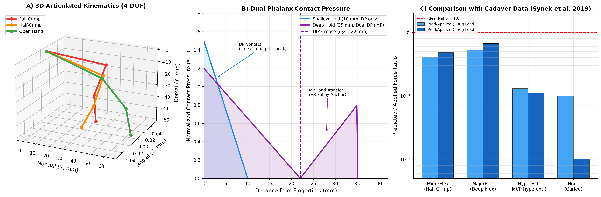
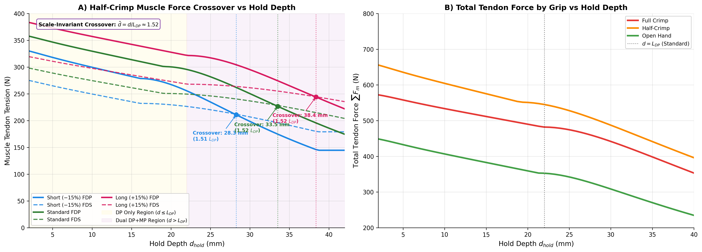
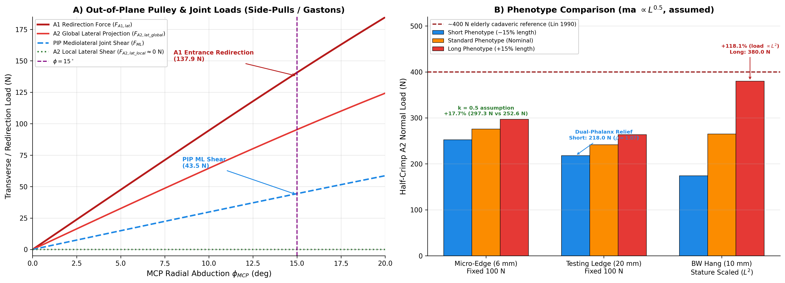

# A Biomechanical Model of the Human Finger in Rock Climbing: Effects of Finger Length on Tendon and Pulley Loads

**Author:** Igor Cerovsky  
*Independent researcher*  
**Date:** October 14, 2026  
*Correspondence:* [igor.cerovsky@gmail.com](mailto:igor.cerovsky@gmail.com)  
*Open Source Repository:* [https://github.com/igorcerovsky/finger](https://github.com/igorcerovsky/finger)

---

## Abstract

**Background:** Climbers and coaches often report that long-fingered climbers find small crimps harder to hold. To our knowledge, no biomechanical model has tested this observation. Classical finger models also assume a fingertip point load, whereas real holds vary in depth (2–45 mm).

**Methods:** We developed a static, four-degree-of-freedom (MCP flexion/abduction, PIP, DIP) model of the middle finger. It includes distributed contact over the distal (DP) and middle (MP) phalanges, pulp compliance, load-dependent skin friction, translating joint centres, Capstan friction at the A2/A4 pulleys, and six muscle–tendon units with force-capacity bounds. Muscle redundancy was resolved by bounded least squares with a prescribed FDP:FDS load-partitioning function. Phenotypes of −15% and +15% length were compared with a standard finger. Tendon moment arms were scaled as $ma \propto L^{k}$ with $k = 0.50$. This value was chosen because $k = 1$ and $k = 0$ gave results inconsistent with practitioner observations; it has no direct experimental support. Results for $k = 0$ and $k = 1$ are reported as a sensitivity range.

**Results:** At a fixed 100 N fingertip load, the long finger required 1.7–4.9% (k = 1), 17–21% (k = 0.5), or 35–41% (k = 0) more A2 pulley force than the short finger. The penalty was therefore governed mainly by the unmeasured scaling exponent. A geometric effect independent of k came from fixed absolute edge depths: a 20 mm edge exceeds the DP length of the short finger ($d/L_{DP} = 1.07$) but not of the long finger (0.79). In half-crimp, the imposed partitioning law produced an FDP-to-FDS dominance crossover at $d/L_{DP} \approx 1.51$ for all phenotypes (28.1, 33.2, 38.3 mm). Under MCP abduction, the redirection force at the A1 pulley followed $2T\sin(\phi/2)$ (140.7 N at 15°, 171.7 N load). The mid-shaft A2 load stayed in-plane. Predicted A2 loads exceed a ~400 N elderly-cadaver reference at loads that climbers sustain in controlled hangs, which suggests that absolute A2 values are overestimated.

**Conclusions:** The model is consistent with a long-finger disadvantage on fixed edges. The size of that disadvantage depends critically on how tendon moment arms scale with phalanx length. Measuring this scaling is the key empirical step needed to confirm or refute the observed long-finger effect.

**Keywords:** finger biomechanics; rock climbing; A2 pulley; crimp grip; contact mechanics; allometry; musculoskeletal model.

---

## 1. Introduction

Pulley injuries are among the most frequent climbing-specific finger injuries (Schöffl et al., 2003; King and Lien, 2017). Planar finger models (An et al., 1983; Schweizer, 2001; Vigouroux et al., 2006; Roloff et al., 2006) show that the crimp grip, with PIP flexion near 90–105° and DIP hyperextension, loads the A2 pulley with forces of about three times the fingertip force (Schweizer, 2001).

Three gaps motivate this study:
1. **Point-load assumption.** Most models apply the external force at the fingertip. On holds deeper than the distal phalanx ($d > L_{DP}$), the middle phalanx also carries load, which alters joint moments (Bourne et al., 2011; Amca et al., 2012).
2. **Out-of-plane loading.** Side-pulls and gastons abduct the MCP joint, and planar models cannot evaluate the resulting transverse loads.
3. **Phenotype gap.** Training studies and reviews have varied load, intensity, and work:rest structure (López-Rivera and González-Badillo, 2019; Stien et al., 2023). No controlled study was found that relates training or loading to finger length.

**Objective.** We aim to quantify, with a transparent and reproducible model, how phalanx length changes internal tendon and pulley loads across hold depths, and to identify which assumptions control the result.

---

## 2. Methods

### 2.1 Kinematics

The finger is a chain of three rigid segments (PP $L_1$, MP $L_2$, DP $L_3$; standard 45/28/22 mm) with the origin at the MCP head. Global axes: $\hat e_x$ normal to the wall, $\hat e_y$ vertical, $\hat e_z$ radial. Segment rotations are composed as $R_{MCP} = R_{flex}(\theta_{MCP})R_{abd}(\phi_{MCP})$, $R_{PIP} = R_{MCP}R_{flex}(\theta_{PIP})$, $R_{DIP} = R_{PIP}R_{flex}(\theta_{DIP})$. Joint centres translate palmarly with flexion, $\delta = c_{max}\,\theta/90^\circ$ ($c_{max}$ = 2.0 mm PIP, 1.5 mm DIP). Baseline grips have $\phi_{MCP} = 0^\circ$.

### 2.2 Distributed contact

For $d_{proj} \le L_3\cos\alpha_3$, a triangular pressure acts on the DP only. Its centroid lies at $s_C = (d_{eff}/3)\tanh(d_{eff}/d_{trans})$ from the tip, with $d_{trans} = 4$ mm. The tanh factor is an assumed representation of load concentrating at the edge lip on very small edges. For deeper holds, load is shared:
$$f_{DP} = \frac{L_3/2}{L_3/2 + x_{MP}^2/[2(L_3+x_{MP})]},\qquad f_{MP} = 1-f_{DP}.$$
This area expression and the MP centroid weighting ($0.40\,p_{geom} + 0.60\,p_{prox}$) are modelling assumptions and have not been fitted to measured pressure data. Pulp compression follows $\delta(F) = \min(k_p\ln(1+F/F_0), 2.5\text{ mm})$ with $k_p = 1.15$ mm and $F_0 = 10$ N (after Serina et al., 1997). Pulp thickness scales as $t_{DP} \propto f^{0.5}$. Skin friction follows $\mu_{eff} = \mathrm{clip}(0.50\,(20/F_N)^{0.15}, 0.25, 0.85)$, consistent with the load-dependent friction of skin reviewed by Derler and Gerhardt (2012).

### 2.3 Muscles and moment arms

Six units are modelled: FDP, FDS, lumbrical (LU), EDC, and radial and ulnar interossei (RI, UI). Moment arms are linear in joint angle; for example, $ma_{FDP,PIP} = 8.24 + 0.050\,\theta_{PIP}$ mm and $ma_{FDS,PIP} = 4.44 + 0.050\,\theta_{PIP}$ mm. Flexor coefficients at PIP and MCP were fitted to tendon paths from Synek et al. (2019). **$ma_{FDP,DIP}$ uses An et al. (1983) values (6.0 mm at 0°) instead of the CT-derived ~4.7 mm.** The CT value gave infeasible DIP equilibrium without intrinsic routing; the substitution raises the DIP moment arm and lowers the FDP force. Flexor abduction moment arms are zero at neutral abduction. Force bounds are $F_{max} = \text{PCSA}\times 35$ N/cm² (RI 98 N, UI 77 N, LU 14 N). EDC is held at its passive floor $F_{EDC,min} = 1.5\,e^{|\theta_{DIP}|/25^\circ}$ N for $\theta_{DIP} < 0$.

**Phenotype scaling.** Segment lengths scale by $f$ = 0.85 / 1.00 / 1.15. Moment arms scale as $f^{k}$. The baseline is $k = 0.50$, selected because it reproduces the practitioner-reported long-finger difficulty, whereas $k = 1$ (isometry) and $k = 0$ (unscaled) did not. **This choice is a calibration to an observation and lacks direct anatomical measurement. The model therefore cannot independently confirm the observation.** Results for $k = 0$ and $k = 1$ are given in Table 4.

### 2.4 Load sharing and pulley forces

Equilibrium $\mathbf A\vec F = \vec M_{ext}$ (DIP, PIP, MCP flexion, MCP abduction) is solved by bounded least squares (`lsq_linear`), with FDP and FDS coupled by
$$F_{FDP} = r_{base}\,(0.20 + 0.80 f_{DP})\,F_{FDS}.$$
The values $r_{base}$ = 1.75 (crimp) and 0.88 (slope/open hand) are model-estimated tendon-force ratios from Vigouroux et al. (2006). The half-crimp value of 1.20 is an interpolation without a direct source. The dependence on $f_{DP}$ is a hypothesis; consequently, any FDP/FDS crossover is a consequence of this law and not an emergent prediction. Capstan friction $T_d = T_p e^{\mu_t\theta}$ uses $\mu_t = 0.08$ (assumed; tendon–pulley friction was measured by Moor et al., 2009). The A2 load is the tendon deflection force at the PIP, shared by fixed fractions (A2 0.50, A4 0.40). These fractions have no direct literature source. "A2 stress" denotes force divided by a nominal 60 mm² interface (mean contact pressure). Forces are reported in the local frame of the loaded phalanx. The A1 redirection force is computed assuming that the proximal tendon line remains aligned with the metacarpal when the MCP abducts.

All tables are generated from the code by `paper/script/sync_paper_tables.py` and `paper/script/k_sensitivity.py`. Table 1 is generated by `human_bonobo/compare_models.py`.

---

## 3. Comparison With Cadaver Data

Synek et al. (2019) applied known tendon loads (300 g, 950 g) to cadaver fingers and recorded fingertip forces in four postures: MinorFlex (DIP/PIP/MCP 35/55/40°), MajorFlex (25/57/55°), HyperExt (45/50/−20°), and Hook (50/65/0°). We applied the measured fingertip force to the model and compared the predicted tendon forces with the applied load. Pred/App is defined as the sum of predicted FDP + FDS + RI + UI divided by the applied tendon load.

### Table 1: Inverse Comparison With Cadaver Measurements (Synek et al., 2019; mean of 3 specimens)

| Posture | Load (g) | $F_{exp}$ (N) | Applied (N) | FDP (N) | FDS (N) | RI (N) | Pred/App |
| :--- | :---: | :---: | :---: | :---: | :---: | :---: | :---: |
| MinorFlex | 300 | 1.263 | 4.91 | 1.1 | 0.9 | 0.0 | 0.41 |
| MinorFlex | 950 | 3.769 | 15.55 | 3.8 | 3.1 | 0.6 | 0.48 |
| MajorFlex | 300 | 0.931 | 4.91 | 1.3 | 1.1 | 0.3 | 0.53 |
| MajorFlex | 950 | 3.366 | 15.55 | 4.8 | 4.0 | 1.6 | 0.67 |
| HyperExt | 300 | 1.569 | 4.91 | 0.0 | 0.0 | 0.6 | 0.13 |
| HyperExt | 950 | 5.000 | 15.55 | 0.0 | 0.0 | 1.7 | 0.11 |
| Hook | 300 | 1.315 | 4.91 | 0.3 | 0.2 | 0.0 | 0.10 |
| Hook | 950 | 4.512 | 15.55 | 0.1 | 0.1 | 0.0 | 0.01 |

The model underestimates tendon force in all postures. Agreement is closest in the flexed postures (0.41–0.67). In HyperExt and Hook, the inverse solution needs almost no flexor force, which indicates that the measured fingertip force direction is not consistent with the model's moment-arm set in those postures. FDP/FDS ratios are imposed and are not used as validation. A forward simulation (applied tendon loads → predicted fingertip force) was not performed and is recommended.

**Literature benchmarks.** At 100 N in crimp on a 10 mm edge, A2/fingertip force = 2.67. This is close to the ≈3:1 measured in vivo by Schweizer (2001), although that ratio was obtained at A2 loads up to ~116 N, so its application at 100–172 N fingertip loads is an extrapolation. The model's crimp/open-hand A2 ratio (4.3×) is much lower than the ≈36× estimated by Vigouroux et al. (2006). A likely reason is that A2 load depends only on PIP angle through a fixed sharing factor, whereas Roloff et al. (2006) identified pulley position relative to the PIP centre as the most influential parameter.

*Figure 1: (A) Kinematics in full crimp, half-crimp, and open hand. (B) Contact pressure for 10 mm (DP only) and 35 mm (DP + MP) holds. (C) Predicted/applied tendon force ratio against Synek et al. (2019); the ideal is 1.0.*

---

## 4. Results

Unless stated otherwise: standard phenotype, vertical wall, 10 mm edge, $k = 0.5$. A load of 171.7 N corresponds to 25% of the body weight of a 70 kg climber on one middle finger. This is within the range of controlled maximal hangs and should not be read as a dynamic load.

### Table 2: Muscle Forces by Grip (Standard Phenotype, 10 mm Edge, Load = 171.7 N)

| Grip Type | Solver Method | $F_{FDP}$ (N) | $F_{FDS}$ (N) | $F_{LU}$ (N) | $F_{EDC}$ (N) | $F_{RI}$ (N) | Total Force (N) | FDP/FDS Ratio | A2 Stress (MPa) |
| :--- | :--- | :---: | :---: | :---: | :---: | :---: | :---: | :---: | :---: |
| **Full Crimp** | Direct (3×3)    |   469.5 |    25.3 |    0.0 |     3.7 |    0.0 |     498.5 |     18.55     |      7.12 |
|                | EMG-Constrained |   337.3 |   192.7 |    0.0 |     3.7 |    0.0 |     533.8 |     1.75      |      7.62 |
|                | LU-Minimizing   |   337.3 |   192.7 |    0.0 |     3.7 |    0.0 |     533.8 |     1.75      |      7.62 |
| **Half-Crimp** | Direct (3×3)    |   472.6 |    95.5 |    0.0 |     0.0 |    0.0 |     568.1 |     4.95      |      7.13 |
|                | EMG-Constrained |   329.7 |   274.8 |    0.0 |     0.0 |    0.0 |     604.5 |     1.20      |      7.59 |
|                | LU-Minimizing   |   329.7 |   274.8 |    0.0 |     0.0 |    0.0 |     604.5 |     1.20      |      7.59 |
| **Open Hand**  | Direct (3×3)    |   374.5 |     0.0 |    0.0 |     0.0 |    0.0 |     374.5 |       —       |      1.65 |
|                | EMG-Constrained |   190.4 |   216.3 |    0.0 |     0.0 |    0.0 |     406.7 |     0.88      |      1.79 |
|                | LU-Minimizing   |   190.4 |   216.3 |    0.0 |     0.0 |    0.0 |     406.7 |     0.88      |      1.79 |

*Note: Values computed with distributed contact on a 10 mm edge (A2 interface 60 mm²). EMG-constrained A2 forces: crimp 457 N, half-crimp 455 N, open hand 107 N (at 100 N: 267 / 265 / 63 N).*

Full crimp and half-crimp produce practically equal A2 loads in this model, and half-crimp needs the highest total tendon force. Open hand gives about 76% lower A2 load and the lowest total force at every depth (Fig. 2B).

### 4.1 Hold depth and FDP/FDS crossover

With half-crimp at 171.7 N, FDS overtakes FDP at 28.1 mm (short), 33.2 mm (standard), and 38.3 mm (long), i.e., at $d/L_{DP} \approx 1.51$ for all phenotypes. The collapse follows from the partitioning law: $r_{emg} = 1$ at $f_{DP} = (1/1.2 - 0.2)/0.8 \approx 0.79$. It is a hypothesis to test with EMG or tendon-force measurements on deep holds. In open hand ($r_{base} < 1$) FDS dominates at all depths. In full crimp FDP dominates over usable crimp depths.

*Figure 2: (A) Half-crimp FDP (solid) and FDS (dashed) forces vs hold depth for the three phenotypes; the crossovers lie at d/L_DP ≈ 1.51. (B) Total tendon force by grip vs hold depth (standard phenotype). The model has no grip-feasibility constraints (e.g., pad roll-off), so it does not predict which grip is chosen on a given edge.*

### 4.2 Out-of-plane loading

Results are for a crimp posture (MCP 2.6°, PIP 106.5°, DIP −22.6°) at 171.7 N with MCP abduction $\phi$ = 0–20°:
- The **mid-shaft A2 load** has zero mediolateral component in the proximal-phalanx frame at all $\phi$, because the tendon stays in the flexion plane.
- The **A1 redirection force** grows as $2T\sin(\phi/2)$ (47.5 / 94.6 / 140.7 N at 5 / 10 / 15°). It follows directly from the assumed neutral proximal tendon line.
- The **PIP mediolateral force** equals $F\sin\phi$ (44.4 N at 15°). It reflects the assumption that the hold reaction stays wall-normal and is therefore a boundary condition, not an emergent result.
- RI reaches its 98 N capacity bound from $\phi \approx 10^\circ$, and total tendon force rises by 16% (547 → 634 N).

### 4.3 Finger length

### Table 3: Phenotype Comparison Across Hold Geometries (Middle Finger, Moment Arms Scaled as $ma \propto L^{0.50}$, Assumed)

| Loading Condition | Phenotype | Total Length (mm) | $L_{DP}$ (mm) | Edge Depth $d$ (mm) | $\rho = d/L_{DP}$ | Contact Mode | Crimp A2 (N) | Half-Crimp A2 (N) |
| :--- | :--- | :---: | :---: | :---: | :---: | :---: | :---: | :---: |
| **Fixed 100 N Hang** (Micro-Edge (6 mm)) | Short (−15%)  |       80.75       |    18.7     |         6.0         |       0.32       | Single (DP)  |        254.0 |             252.6 |
|                            | Standard      |       95.00       |    22.0     |         6.0         |       0.27       | Single (DP)  |        276.6 |             275.8 |
|                            | Long (+15%)   |      109.25       |    25.3     |         6.0         |       0.24       | Single (DP)  |        297.4 |             297.3 |
| **Fixed 100 N Hang** (Medium Edge (10 mm)) | Short (−15%)  |       80.75       |    18.7     |        10.0         |       0.53       | Single (DP)  |        243.6 |             241.0 |
|                            | Standard      |       95.00       |    22.0     |        10.0         |       0.45       | Single (DP)  |        267.0 |             265.1 |
|                            | Long (+15%)   |      109.25       |    25.3     |        10.0         |       0.40       | Single (DP)  |        288.5 |             287.2 |
| **Fixed 100 N Hang** (Testing Ledge (20 mm)) | Short (−15%)  |       80.75       |    18.7     |        20.0         |       1.07       | Dual (MP+DP) |        222.1 |             218.0 |
|                            | Standard      |       95.00       |    22.0     |        20.0         |       0.91       | Single (DP)  |        245.1 |             241.7 |
|                            | Long (+15%)   |      109.25       |    25.3     |        20.0         |       0.79       | Single (DP)  |        268.0 |             263.6 |
| **Bodyweight Hang** (10 mm Edge, Stature $L^2$) | Short (−15%, 50.6 kg) |       80.75       |    18.7     |        10.0         |       0.53       | Single (DP)  |        176.8 |             174.2 |
|                            | Standard (70.0 kg) |       95.00       |    22.0     |        10.0         |       0.45       | Single (DP)  |        267.0 |             265.1 |
|                            | Long (+15%, 92.5 kg) |      109.25       |    25.3     |        10.0         |       0.40       | Single (DP)  |        381.2 |             380.0 |

*Note: In the Fixed 100 N Hang, all phenotypes carry the same fingertip load. In the Bodyweight Hang, load is scaled with stature-associated mass ($m \propto L^2$, constant BMI). The ~400 N value is an elderly-cadaver A2 reference (Lin et al., 1990) and is not a validated failure threshold for climbers.*

### Table 4: Sensitivity of the Long-Finger Penalty to the Moment-Arm Exponent k (Crimp A2, 100 N)

| k | 6 mm: L vs S | 10 mm: L vs S | 20 mm: L vs S | Bodyweight hang 10 mm, A2 S / L (N) |
| :---: | :---: | :---: | :---: | :---: |
| 1.0 (isometric) | +1.7% | +2.9% | +4.9% | 190.6 / 357.1 (+87%) |
| 0.5 (baseline) | +17.1% | +18.4% | +20.7% | 176.8 / 381.2 (+116%) |
| 0.0 (unscaled) | +34.8% | +36.3% | +38.7% | 164.0 / 407.1 (+148%) |

Findings:
1. **Fixed load, k-dependence.** The long-vs-short penalty at a fixed load ranges from about +2% to +39%, depending mainly on k (Table 4). The baseline result (+17–21%) therefore inherits the uncertainty of k.
2. **Fixed edge depth (independent of k).** For every k, the penalty increases with edge depth up to the point where the short finger reaches MP contact ($d/L_{DP} \ge 1$ at 20 mm). Fixed absolute edges are relatively shallower for long fingers.
3. **Bodyweight scaling.** With load ∝ $L^2$, absolute A2 load rises by 87–148% (long vs short). Muscle and pulley cross-sections plausibly also scale with $\approx L^2$. Under isometry the load relative to tissue size would then change little. Whether pulley strength scales with finger size is not known.

*Figure 3: (A) A1 redirection force, global A2 lateral projection, local A2 lateral force (zero), and PIP mediolateral force vs MCP abduction (crimp, 171.7 N). (B) Half-crimp A2 load for the three phenotypes (k = 0.5 assumed): 100 N on 6 mm and 20 mm edges, and a bodyweight-scaled hang on a 10 mm edge.*

---

## 5. Discussion

**Main finding.** The model is consistent with the reported long-finger difficulty on small edges, through two mechanisms. The first is a **fixed-edge-depth effect**, which is robust to the scaling assumption but small (≈2–5% at fixed load under isometry). The second is a **leverage effect** whose magnitude is set almost entirely by how tendon moment arms scale with phalanx length. Because k = 0.5 was chosen to match the observation, the model does not independently demonstrate the effect. It does identify the quantity that decides it: measuring flexor moment arms (e.g., by MRI or ultrasound) across individuals with different phalanx lengths would directly test the hypothesis.

**Absolute load calibration.** At 171.7 N, the model predicts 457 N of A2 load, above the ~400 N elderly-cadaver reference (Lin et al., 1990). Climbers sustain such loads in controlled hangs without rupture. This suggests that the model overestimates absolute A2 loads at high fingertip forces, that athletic pulleys are stronger than elderly cadaveric ones, or both. A2 values are therefore best interpreted comparatively (between grips, depths, phenotypes) and not as rupture predictions. Pulleys fail at lower loads under eccentric than concentric loading (Schöffl I. et al., 2009). Because the model is static, it cannot address dynamic loading.

**Grip comparison.** The model reproduces the direction of the crimp vs open-hand difference reported in the literature but underestimates its size (4.3× vs ≈36×; Vigouroux et al., 2006), and it does not separate full crimp from half-crimp. Adding a pulley-position parameter (Roloff et al., 2006) is the main suggested improvement.

**Out-of-plane loads.** Transverse loading at A1 and at the PIP joint results from the assumed tendon line and the assumed direction of the hold reaction. It is not an independent prediction. Measurements on an instrumented tendon-driven finger, or in vivo, are needed.

**Limitations.** The model is static. It represents a single digit without inter-digit (quadriga) coupling. Contact and load-sharing parameters are assumed, and FDP:FDS partitioning is prescribed. The cadaver comparison is inverse-only, with poor agreement outside flexed postures. No global (e.g., Morris/Sobol) sensitivity analysis has been reported beyond the k sweep.

---

## 6. Implications (Evidence-Tiered)

Tiers: **[M]** model-derived under stated assumptions; **[L]** supported by external literature; **[H]** hypothesis for testing.

1. **Open hand for volume work** [M, L]: the model shows ~76% lower A2 load than crimp; the direction agrees with Schweizer (2001) and Vigouroux et al. (2006).
2. **Edge depth relative to finger length** [M, H]: fixed edges (e.g., 20 mm) load fingers of different length differently. Normalising test edges to $L_{DP}$ (e.g., $d = 0.8\,L_{DP}$) is proposed for testing and has not been validated.
3. **Long-finger load management** [H]: conservative crimp volume for long-fingered climbers is plausible but rests on the unmeasured k. No intervention data exist.
4. **Alignment in side-pulls** [M, H]: the model's A1 redirection load increases with MCP abduction under its assumptions. Aligning the forearm with the pull direction is a reasonable practitioner heuristic.
5. **Adolescents** [L]: the most common overuse injury is the primary periphyseal stress injury (PPSI) of the middle-phalanx base. Schöffl et al. (2025) proposed a dedicated five-grade (0–4) classification with sclerosis subtypes; Salter-Harris is considered unsuitable for these chronic injuries. The model does not represent the physis.
6. **Skin friction** [L]: skin friction depends strongly on skin hydration; very dry, cold skin shows lower friction than moderately hydrated skin (Derler and Gerhardt, 2012). This is consistent with the climbers' experience of sudden slips ("dry-firing") in cold, dry conditions.

---

## 7. Conclusion

We present an open, reproducible 3D static finger model that combines distributed hold contact, pulley-load estimation, and phenotype scaling. Fixed absolute edge depths impose a small, assumption-robust disadvantage on long fingers. Any larger leverage disadvantage depends on how tendon moment arms scale with phalanx length, which is presently unmeasured. The adopted k = 0.5 is a calibration choice and a proposal for future research. Measuring this scaling, together with instrumented-edge pressure data and forward cadaver validation, is the recommended next step.

---

## Declarations

**Ethics:** Only published, anonymised cadaver data (Synek et al., 2019) were used.  
**Competing interests:** None.  
**Data and code:** [https://github.com/igorcerovsky/finger](https://github.com/igorcerovsky/finger).

---

## References

1. Amca, A.M., Vigouroux, L., Aritan, S., Berton, E. (2012). Effect of hold depth and grip technique on maximal finger forces in rock climbing. *Journal of Sports Sciences*, 30(7), 669–677.
2. An, K.N., Ueba, Y., Chao, E.Y., Cooney, W.P., Linscheid, R.L. (1983). Tendon excursion and moment arm of index finger muscles. *Journal of Biomechanics*, 16(6), 419–425.
3. Bourne, R., Halaki, M., Vanwanseele, B., Clarke, J. (2011). Measuring lifting forces in rock climbing: effect of hold size and fingertip structure. *Journal of Applied Biomechanics*, 27(1), 40–46.
4. Derler, S., Gerhardt, L.C. (2012). Tribology of skin: review and analysis of experimental results for the friction coefficient of human skin. *Tribology Letters*, 45(1), 1–27.
5. King, E.A., Lien, J.R. (2017). Flexor tendon pulley injuries in rock climbers. *Hand Clinics*, 33(1), 141–148.
6. Lin, G.T., Cooney, W.P., Amadio, P.C., An, K.N. (1990). Mechanical properties of human pulleys. *Journal of Hand Surgery (British Volume)*, 15(4), 429–434.
7. López-Rivera, E., González-Badillo, J.J. (2019). Comparison of the effects of three hangboard strength and endurance training programs on grip endurance in sport climbers. *Journal of Human Kinetics*, 66, 183–195.
8. Moor, B.K., Nagy, L., Snedeker, J.G., Schweizer, A. (2009). Friction between finger flexor tendons and the pulley system in the crimp grip position. *Clinical Biomechanics*, 24(1), 20–25.
9. Roloff, I., Schöffl, V.R., Vigouroux, L., Quaine, F. (2006). Biomechanical model for the determination of the forces acting on the finger pulley system. *Journal of Biomechanics*, 39(5), 915–923.
10. Schöffl, I., Oppelt, K., Jüngert, J., Schweizer, A., Bayer, T., Neuhuber, W., Schöffl, V. (2009). The influence of concentric and eccentric loading on the finger pulley system. *Journal of Biomechanics*, 42(13), 2124–2128.
11. Schöffl, V., Hochholzer, T., Winkelmann, H.P., Strecker, W. (2003). Pulley injuries in rock climbers. *Wilderness & Environmental Medicine*, 14(2), 94–100.
12. Schöffl, V., Iruretagoiena, S., Nelson, T., Miro, P. (2025). Proposal of a specific classification of primary periphyseal stress injuries in adolescent rock climbers. *Frontiers in Sports and Active Living*.
13. Schweizer, A. (2001). Biomechanical properties of the crimp grip position in rock climbers. *Journal of Biomechanics*, 34(2), 217–223.
14. Serina, E.R., Mote, C.D., Rempel, D. (1997). Force response of the fingertip pulp to repeated compression—effects of loading rate, loading angle and anthropometry. *Journal of Biomechanics*, 30(10), 1035–1040.
15. Stien, N., Saeterbakken, A.H., Andersen, V. (2023). Comparison of finger flexor strength training protocols in rock climbers: a systematic review. *Sports Medicine – Open*, 9, 23.
16. Synek, A., Lu, S.-C., Vereecke, E.E., Nauwelaerts, S., Kivell, T.L., Pahr, D.H. (2019). Musculoskeletal models of a human and bonobo finger: parameter identification and comparison to in vitro experiments. *PeerJ*, 7, e7470.
17. Vigouroux, L., Quaine, F., Labarre-Vila, A., Moutet, F. (2006). Estimation of finger muscle tendon tensions and pulley forces during specific sport-climbing grip techniques. *Journal of Biomechanics*, 39(14), 2583–2592.
